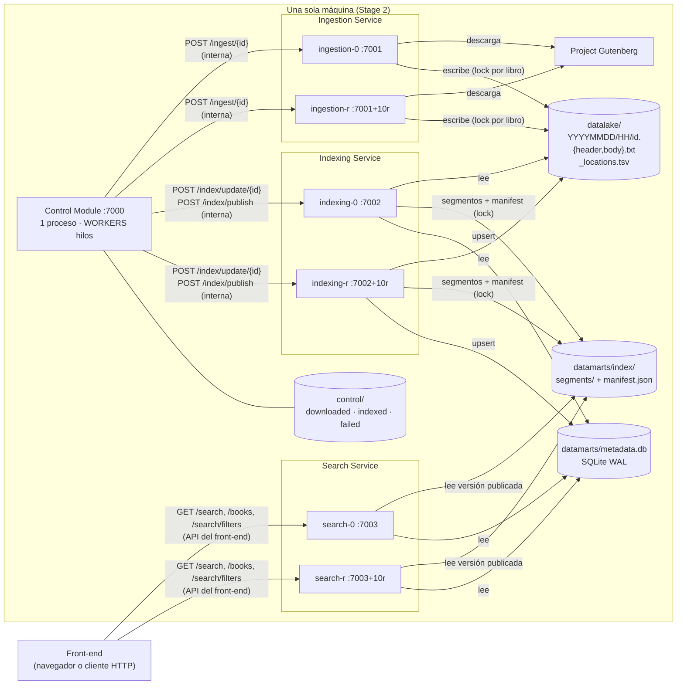

# Arquitectura del Stage 2

## Diagrama

- Las flechas desde el front-end son la API pública. Las del Control Module son las APIs
  internas.
- El resto de relaciones son ficheros compartidos dentro del mismo host, con los contratos
  que se describen en `api/ENDPOINTS.md`.

## Procesos, réplicas e hilos

| Componente | Réplicas | Hilos por proceso | Cómo se reparte el trabajo | Estado compartido y cómo se protege |
|---|---|---|---|---|
| Control Module | 1 (único orquestador) | `WORKERS` libros en paralelo (4), un hilo publicador y el pool de Jetty de la API de administración | Lee la lista de `BOOK_IDS` en orden | Ficheros de control con métodos `synchronized` y `SYNC` en cada escritura |
| Ingestion | `INGESTION_REPLICAS` | Jetty, `HTTP_THREADS` (32) | El Control Module reparte en round-robin y, si una réplica falla, prueba con la siguiente | Datalake: rename atómico, lock por libro y lock de `_locations.tsv` (`FileLock` + `ReentrantLock`) |
| Indexing | `INDEXING_REPLICAS` | Jetty `HTTP_THREADS`; `INDEX_THREADS` para el rebuild; 1 hilo de compactación | Afinidad `book_id % N` (el mismo libro siempre va a la misma réplica) | Buffer de pendientes (`ConcurrentHashMap`), `ReentrantLock` de publicación en el proceso, `FileLock` del manifest entre réplicas, SQLite en WAL con `busy_timeout` |
| Search | `SEARCH_REPLICAS` | Jetty `HTTP_THREADS`; 1 hilo que refresca el índice | El cliente o el balanceador reparte las consultas | Solo lectura. Snapshot inmutable por consulta (`AtomicReference`), caché LRU sincronizada de segmentos inmutables y una conexión SQLite por hilo |

- **Hilos de Jetty.** `HTTP_THREADS` es el máximo del `QueuedThreadPool` de Jetty (Javalin
  no tiene un valor propio). El mínimo es `min(4, HTTP_THREADS)`.
- **Hilos virtuales.** Están desactivados, que es el valor por defecto de Javalin 6.
- **Peticiones de más.** Si llegan más peticiones que hilos libres, Jetty las encola.
- **Coste de añadir réplicas.** En una sola máquina, más réplicas compiten por la misma CPU,
  memoria y disco. Las medidas de `scripts/integration_bench.sh` muestran cuándo esto deja
  de mejorar el throughput.

## Cómo se evitan los problemas de concurrencia

| Problema | Solución |
|---|---|
| Indexar un libro a medias | Solo está disponible cuando aparece en `_locations.tsv`, que se escribe después de los dos ficheros. Indexing responde 409 si no lo encuentra |
| Que la búsqueda lea un índice a medio actualizar | Segmentos inmutables + `manifest.json` reemplazado de forma atómica. Cada consulta usa una sola versión |
| Dos réplicas publicando a la vez | Lock del manifest (lectura-modificación-escritura). Los nombres de segmento son únicos |
| Libro duplicado en el índice | El manifest guarda los libros publicados. Publicar de nuevo los mueve a `skipped`, y la afinidad evita indexarlo dos veces en paralelo |
| Ingerir dos veces el mismo libro | Lock por libro y comprobación previa (`already_present`) |
| Metadatos duplicados | `INSERT OR REPLACE` por `book_id` |
| Hilos de Jetty agotados | Pool acotado con cola. Las operaciones largas (rebuild) son de administración |
| Contención en SQLite | WAL (los lectores no bloquean al escritor) y `busy_timeout` de 10 s. Hay un solo escritor lógico por lote |
| Corte a mitad del flujo | Los ficheros de control se escriben después de cada confirmación y todas las operaciones son idempotentes, así que al reanudar se repiten sin efectos secundarios |
| Réplica de indexación caída | Reintentos con espera exponencial. Tras varios fallos de publicación, sus libros se reenvían a otra réplica |
| Segmentos borrados mientras se leen | Los segmentos retirados se borran pasado `RETIRED_GRACE_MS` (60 s), mucho más que `REFRESH_MS` |

## Preparación para el Stage 3 (clúster)

| Supuesto actual (un host) | Cambio propuesto |
|---|---|
| URLs `localhost` y lista fija de réplicas | Descubrimiento de servicios o DNS del orquestador de contenedores, con un balanceador delante de Search |
| Datalake y datamarts en ficheros locales | Almacenamiento compartido (por ejemplo, un sistema de ficheros distribuido o almacenamiento de objetos) o datos expuestos por API |
| `FileLock` y rename atómico | Coordinación distribuida (bloqueos con lease) o transacciones de una base de datos |
| SQLite | Base de datos cliente-servidor (por ejemplo, PostgreSQL) |
| Un único Control Module | Cola persistente (broker) con acks y reintentos, o elección de líder |
| Search relee un manifest local | Evento de "nueva versión publicada", o sondeo de un manifest en el almacenamiento compartido |
